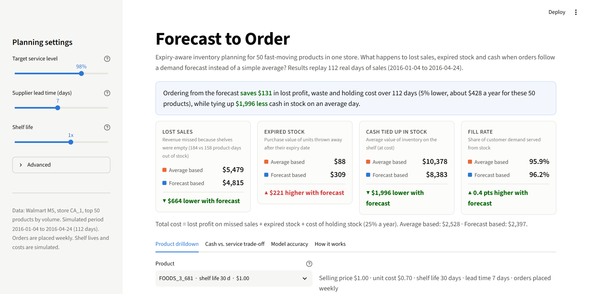
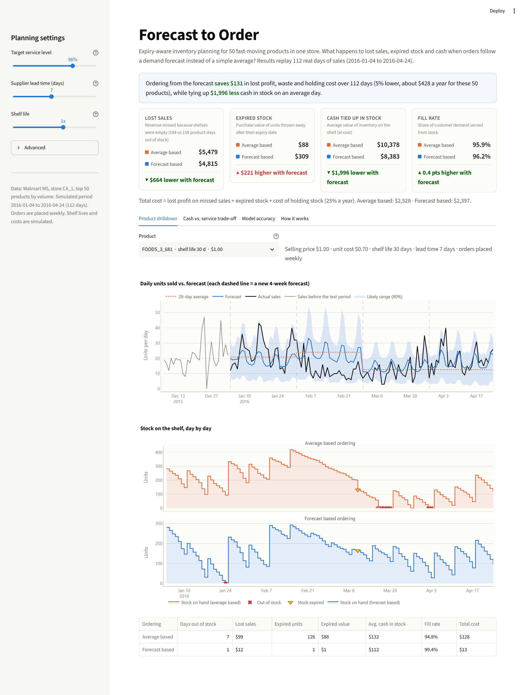
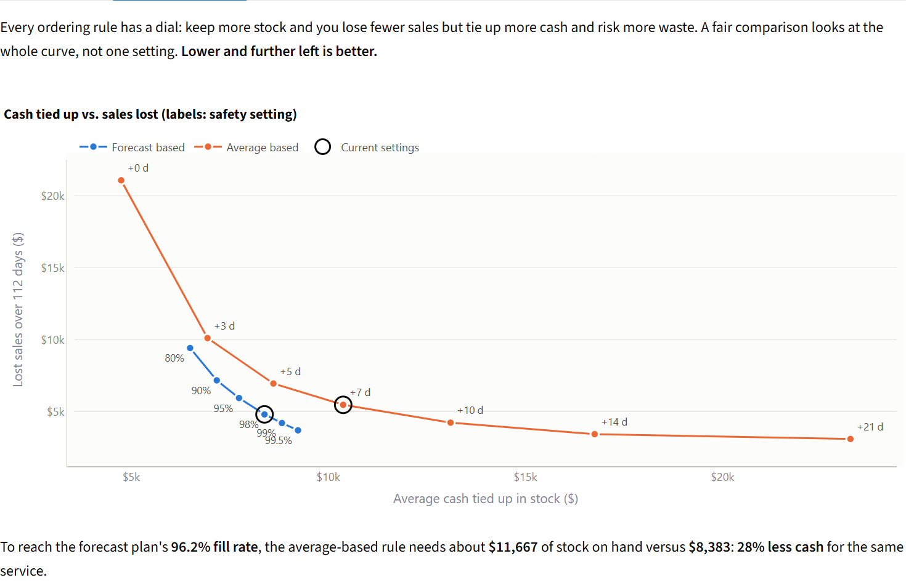
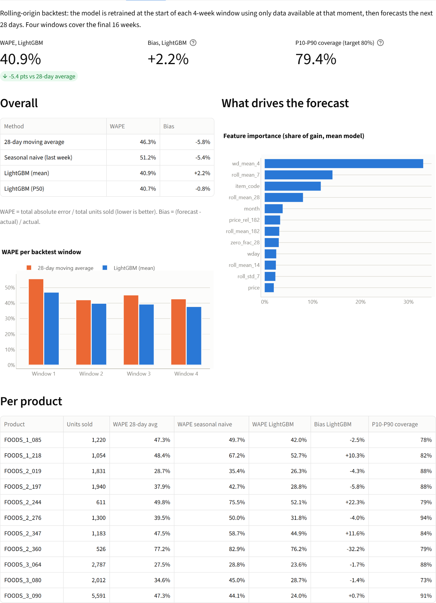
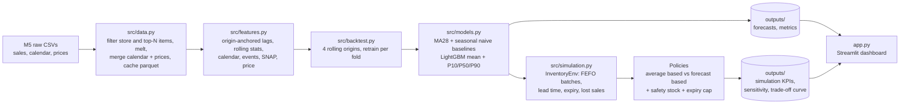

# Forecast to Order: an expiry-aware inventory system

**From a sales forecast to a purchase order, measured in money rather than accuracy scores.**

Pharmacies and pharma distributors lose money three ways on the same shelf. They run out of products customers
need (lost sales, and those customers may not come back). They over-order products that sit there (cash tied up in
stock). And short-dated products expire and get thrown away. Most stores still order with a rule of thumb like
*"order enough to cover the last month's average for the next few weeks"*. That rule can't see weekly patterns,
holidays, price changes or trends, and it knows nothing about expiry dates. This project builds a forecast with
uncertainty ranges, turns it into weekly orders with safety stock and expiry limits, and replays both ordering
methods against 16 weeks of real sales to show what each one costs.



## Results

Backtest on Walmart M5 store **CA_1**, its **50 best-selling products**, replaying **112 days**
(2016-01-04 to 2016-04-24). Settings: weekly ordering, 7-day supplier lead time, 98% target service level.

| Over 112 days, 50 products | Average based ordering (today's rule of thumb) | Forecast based ordering | Difference |
|---|---:|---:|---:|
| Lost sales (revenue missed on empty shelves) | $5,479 | **$4,815** | **-$664 (-12%)** |
| Product-days out of stock | 184 | **158** | -26 (-14%) |
| Expired stock thrown away (at cost) | **$88** | $309 | +$221 |
| Cash tied up in stock (average, at cost) | $10,378 | **$8,383** | **-$1,996 (-19%)** |
| Fill rate (demand served from stock) | 95.9% | **96.2%** | +0.3 pts |
| **Total cost** (lost profit + expired stock + holding cost) | $2,528 | **$2,397** | **-$131 (-5%)** |

**At the same service level the gap is bigger.** Comparing single settings is unfair because each rule has a safety
dial. Tracing both full trade-off curves (dashboard tab *Cash vs. service trade-off*), the average rule needs about
**$11,667** of stock to reach the forecast plan's 96.2% fill rate, versus **$8,383**. That is **28% less cash for the
same service**. At every stock level tested, the forecast curve loses fewer sales.

**Forecast accuracy** (4 rolling 28-day windows, 79,625 units):

| Method | WAPE (lower is better) | Bias |
|---|---:|---:|
| 28-day moving average | 46.3% | -5.8% |
| Seasonal naive (same weekday last week) | 51.2% | -5.4% |
| **LightGBM global model (mean)** | **40.9%** | +2.2% |
| LightGBM P50 | 40.7% | -0.8% |

The P10-P90 range contains **79.4%** of actual days, against an 80% target. LightGBM beats the moving average in
every one of the four windows.

**Where it does *not* win.** Honest results matter more than flattering ones:

* **Expired stock is higher** with forecast-based ordering ($309 vs $88). Most of it comes from a handful of products
  whose recorded sales fell to zero for weeks. That pattern is Walmart's own out-of-stocks or delistings, not
  customers stopping buying. The model expects sales to return, orders ahead, and is caught out.
* **With a 14-day lead time, forecast-based ordering loses**: total cost $3,637 vs $3,124. Forecasts three weeks out
  are much less reliable, and the safety stock formula assumes daily errors are independent, which understates
  multi-week risk. A better policy for long lead times is on the roadmap.
* **At low service targets** (80-90%) the forecast plan holds very little stock and loses more sales than the rule of
  thumb. The service level has to be chosen deliberately.

Sensitivity (all at 98% service; full table in `outputs/sensitivity.csv`):

| Scenario | Total cost, average based | Total cost, forecast based | Cash tied up, average → forecast |
|---|---:|---:|---:|
| Lead time 2 days | $1,800 | **$1,479** (-18%) | $10,336 → $6,821 |
| Lead time 7 days (default) | $2,528 | **$2,397** (-5%) | $10,378 → $8,383 |
| Lead time 14 days | **$3,124** | $3,637 (+16%) | $10,759 → $10,366 |
| Shelf lives halved | $4,259 | **$3,789** (-11%) | $10,224 → $8,237 |
| Shelf lives doubled | $2,421 | **$2,081** (-14%) | $10,384 → $8,428 |

The money involved is small because M5 products are $1-5 grocery items and this is 50 products in one store. The
percentages are what carry over to pharmacy SKUs with higher unit values.

## Dashboard

```bash
streamlit run app.py
```

* **Top row:** both ordering methods side by side (lost sales, expired stock, cash tied up, fill rate), with the
  money difference highlighted.
* **Product drilldown:** actual sales vs. forecast with its likely range, and day-by-day stock under each method
  with stockouts (✖) and expiry events (▼) marked.
* **Sidebar:** service level, lead time and shelf life. Forecasts are precomputed, so only the simulation reruns
  (under a second).
* **Cash vs. service trade-off:** the full curve for each method.
* **Model accuracy:** WAPE, bias, interval coverage, per-window and per-product tables, and feature importance.
  ML metrics are kept off the main view on purpose.

| Product drilldown | Trade-off | Model accuracy |
|---|---|---|
|  |  |  |

## How it works



**Data** (`src/data.py`). The wide sales file is read in chunks with `int16` day columns and filtered to one store
*before* melting. The top N items by total units are kept, then joined with the calendar and weekly prices. The
result is cached as parquet (`data/processed/`).

**Features** (`src/features.py`). Every row is *(item, forecast origin, horizon h)* and every sales-based feature
uses only days up to the origin. Lags 7/14/28 are anchored to the most recent same weekday not after the origin.
Rolling means/std over 7-182 days come from prefix sums. Calendar, events, SNAP and planned prices describe the
target day (known in advance, the standard M5 assumption). `tests/test_leakage.py` scrambles every sale after the
origin and asserts that the features don't change, with a control test proving the check detects real changes.

**Models** (`src/models.py`). Baselines: 28-day moving average and seasonal naive. Main model: **one global
LightGBM** across all items with horizon as a feature (direct multi-horizon). It uses a Tweedie objective for the
mean and three quantile models (P10, P50, P90) for the range.

**Backtest** (`src/backtest.py`). Four rolling origins, 28 days apart, ending at the last observed day. Each fold
trains only on rows whose target day is at or before the origin; this is asserted in code and in tests. The fold
model also produces a fresh forecast **every day** of its window, so the simulation never uses information from the
future.

**Simulation** (`src/simulation.py`). `InventoryEnv` is a single-item environment with a `reset()` / `step(order)`
interface ready for a reinforcement learning agent. Orders arrive after the lead time as a batch with its own expiry
date. Sales come from the soonest-expiring batch first (FEFO), expired units are discarded, and unmet demand is lost.
Reward = -(lost margin + expired cost + holding cost).

* *Average based*: every 7 days, order up to `avg daily sales (28d) × (lead time + 7 + 7 extra days)`.
* *Forecast based*: every 7 days, order up to `Σ forecast mean over lead time + 7 days + z(service level) × σ`.
  σ is derived from the P10-P90 width. The order-up-to level is capped at what is forecast to sell before a new
  batch would expire.

Simulated economics (configurable in `src/config.py`): shelf life drawn from 30/60/90/180 days (seed 42), unit cost =
70% of selling price, holding cost = 25% of unit cost per year, lost sale = lost margin.

## Run it

**1. Get the data.** Join the Kaggle competition
[M5 Forecasting - Accuracy](https://www.kaggle.com/competitions/m5-forecasting-accuracy/data) (accept the rules),
then download from the Data tab or with the Kaggle CLI:

```bash
kaggle competitions download -c m5-forecasting-accuracy
```

Put these files in `./data/`:

```
data/
├── sales_train_evaluation.csv   # preferred (d_1..d_1941); sales_train_validation.csv (d_1..d_1913) also works
├── calendar.csv
└── sell_prices.csv
```

The pipeline uses the evaluation file when it is present and falls back to the validation file. The published
results above use the **validation** file (data through 2016-04-24).

**2. Install** (Python 3.11+; tested on 3.13):

```bash
python -m venv .venv
.venv\Scripts\activate          # Windows  (macOS/Linux: source .venv/bin/activate)
pip install -r requirements.txt
```

**3. Run the pipeline** (about 2.5-3 minutes on a laptop). It writes everything to `./outputs/`:

```bash
python run_pipeline.py                         # CA_1, top 50 items, 4 folds
python run_pipeline.py --store TX_2 --items 200 # scale up
```

**4. Open the dashboard and run the tests**:

```bash
streamlit run app.py
pytest -q
```

`python scripts/take_screenshots.py` regenerates the images in `docs/images/` using a locally installed Edge or
Chrome.

| Output | Contents |
|---|---|
| `metrics_overall.csv`, `metrics_per_fold.csv`, `metrics_per_item.csv` | WAPE, bias, P10-P90 coverage |
| `simulation_summary.csv`, `simulation_per_item.csv` | Business KPIs per policy (and per item) |
| `sensitivity.csv`, `frontier.csv` | Service level / shelf life / lead time scenarios; trade-off curves |
| `feature_importance.csv`, `item_params.csv`, `folds.csv`, `run_info.json` | Model and run metadata |
| `forecasts_*.parquet`, `simulation_daily.parquet`, `sim_inputs.npz` | Large files (git-ignored) used by the app |

## Project structure

```
├── run_pipeline.py        # one command: data -> backtest -> metrics -> simulation -> outputs/
├── app.py                 # Streamlit dashboard
├── src/
│   ├── config.py          # store, item count, horizon, folds, simulation economics
│   ├── data.py            # load, filter, melt, merge, cache
│   ├── features.py        # leakage-safe feature builder
│   ├── models.py          # baselines + global LightGBM (mean + quantiles)
│   ├── backtest.py        # rolling-origin backtest and metrics
│   └── simulation.py      # InventoryEnv (reset/step), policies, KPIs
├── tests/                 # leakage tests + simulation sanity checks (32 tests)
├── scripts/take_screenshots.py
└── docs/images/
```

## Limitations

* **Shelf lives and costs are simulated.** M5 has no expiry, cost or supplier data, so shelf life, unit cost
  (70% of price), holding rate and lead time are assumptions. Change them in `src/config.py` or the dashboard.
* **Sales are not demand.** Recorded zeros include the store's own stockouts and delistings, so demand is censored.
  Both the forecasts and the "lost sales" in the replay inherit this.
* **One store, 50 products, mostly food.** This is a stand-in for a pharmacy. Fast-moving food items share the key
  dynamics (perishability, weekly patterns, promotions) but not the regulatory side (lot recalls, returns to
  wholesaler, minimum remaining shelf life at delivery).
* **Simple policies.** Weekly review, no order minimums, case packs or supplier constraints. Safety stock assumes
  independent daily errors, which hurts at long lead times (see results).
* **16 weeks of replay.** Long enough to see the trade-offs, too short to capture full seasonality.

## Next steps

* **Full dataset:** all 10 stores and ~3,000 products. The pipeline is already parameterised (`--store`,
  `--items`); the main change would be moving the feature builder from dense matrices to chunked processing.
* **Better ordering policies:** directly simulated multi-week demand paths (quantile-based sampling) instead of the
  normal approximation; per-item service levels from the cost of a lost sale vs. the cost of waste (newsvendor
  critical ratio); case-pack and minimum-order constraints; flagging likely supply-side zeros so the model stops
  treating them as demand.
* **RL-based replenishment:** `InventoryEnv` already exposes `reset()` / `step(order)` with a cost-based reward and
  an observation that includes batch ages and the probabilistic forecast. Next would be a Gymnasium wrapper, a
  PPO/SAC agent trained across items, and benchmarking it against the forecast policy on the same trade-off curve.
* **Pharma realism:** real lot-level expiry data, minimum remaining shelf life at receipt, returns to wholesaler.
